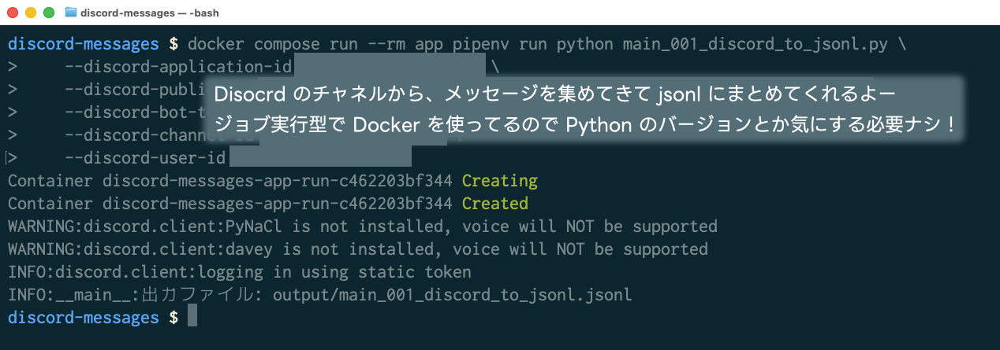
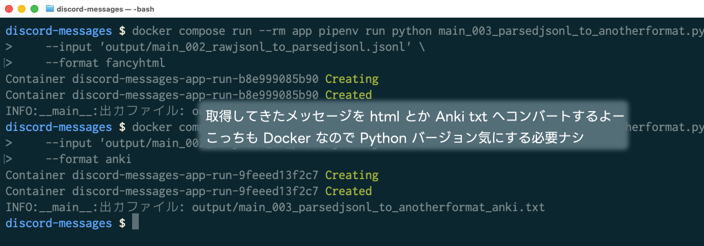
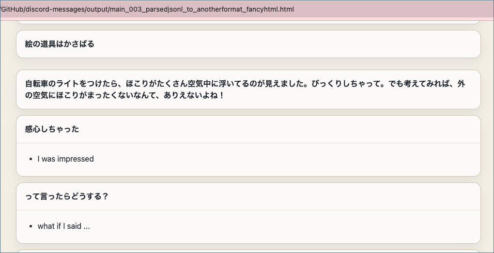
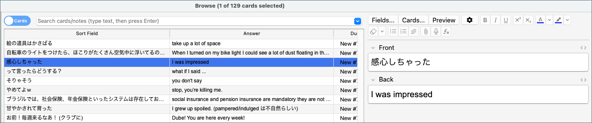

discord-messages
===

今回のオモチャがやること

- Discord のチャネルからメッセージを獲ってきて、整形して、別のフォーマット (html とか Anki txt) へコンバートする
- まあ正直 html はオマケで、メインは Anki txt だよね

今回のオモチャのウリ

- Docker を使っているので、 Python バージョン気にする必要ナシ!
- Docker ジョブ実行型で使うのにちょっと慣れてきた。普段は常駐サービスばっかりだもんね
- 「メッセージ取得」「整形」「コンバート」を 001, 002, 003 という別スクリプトにしてるのは分かりやすい
- 「整形」スクリプトに parser 引数用意してるのクールすぎ (まあ default しか用意してないけど)
- 「コンバート」スクリプトに format 引数用意してるのもクールすぎ (いまのとこ fancyhtml, anki)









## 実行環境と主要依存

- Docker / Docker Compose (ホストに Python は不要)
- Python 3.14 (`Dockerfile` のベースイメージ `python:3.14.10-slim-trixie`)
- pipenv (`Pipfile` / `Pipfile.lock`)
- discord.py: メッセージ取得 (001)
- FastAPI / uvicorn / python-dotenv: web UI (101)
- Ruff: linter (dev)
- pip-audit: 依存パッケージの既知脆弱性チェック (dev)
- httpx2: web UI テストの `TestClient` 用 (dev)

## Discord 側の準備

- Discord Application の作成が必要: https://discord.com/developers/applications
- Bot Token も必要。このとき Message Content Intent ON が必要。
- Discord 側で developer mode ON が必要: https://qiita.com/ymzkjpx/items/8f42733d0fb67d454e27

## How to start

```bash
# 最初のセットアップ
# いつもは up -d --build してるけど、それはサーバとかウェブアプリのため (常駐サービス型)
# 今回はそれぞれのスクリプトを単発で動かすだけで、最初のビルドは pipenv と dependencies を用意するのだけが目的 (ジョブ実行型) なので build だけでいいよ
docker compose build

# 自慢の web UI はこちら。 001 → 002 → 003 をまとめて実行して、成果物は output/ に出るよ。
# フォームの初期値を入れておきたいなら .env を用意してね (無くても動く)。
cp -n .env.example .env  # -n: 既にある .env は上書きしない
(sleep 2 && open http://localhost:8000) & docker compose run --rm --service-ports web && open output
# もしポートが埋まってたら↓ (bot token を扱うので、必ず 127.0.0.1 にだけ公開してね)
# (sleep 2 && open http://localhost:8080) & docker compose run --rm -p 127.0.0.1:8080:8000 web && open output
# NOTE: web UI は bot token を返すので、ホストの 127.0.0.1 にだけ公開し、 Host ヘッダも localhost / 127.0.0.1 以外は拒否します。
#       別サイト (Origin が自分自身と違う) からの POST も 403 で拒否します。

# Python スクリプトを 1 本ずつ動かすならこう。成果物は output/ に出るよ。
# bot token は --discord-bot-token の代わりに環境変数 DISCORD_BOT_TOKEN でも渡せる。
# read -s で入力すれば、シェル履歴にもプロセス一覧にも残らない。
read -rs DISCORD_BOT_TOKEN && export DISCORD_BOT_TOKEN
docker compose run --rm -e DISCORD_BOT_TOKEN app pipenv run python main_001_discord_to_jsonl.py --discord-channel-id <チャネル ID>
docker compose run --rm app pipenv run python main_002_rawjsonl_to_parsedjsonl.py --input output/main_001_discord_to_jsonl.jsonl
docker compose run --rm app pipenv run python main_003_parsedjsonl_to_anotherformat.py --input output/main_002_rawjsonl_to_parsedjsonl.jsonl --format anki

# ほかのオプション (ユーザ絞り込み、日付、件数、出力先など) は help を見てね。
docker compose run --rm app pipenv run python main_001_discord_to_jsonl.py --help
docker compose run --rm app pipenv run python main_002_rawjsonl_to_parsedjsonl.py --help
docker compose run --rm app pipenv run python main_003_parsedjsonl_to_anotherformat.py --help
```

## 依存の追加・更新

```bash
# Pipfile / Pipfile.lock はバインドマウント経由でホスト側が更新される。
docker compose run --rm app pipenv install <パッケージ>        # dev 依存なら --dev
docker compose run --rm app pipenv update                      # ロックファイルの更新
# モジュール入れたら build し直してねー。 (venv はイメージの中にあるので)
docker compose build
```

## コミット前確認

```bash
# Ruff (linter)
docker compose run --rm app pipenv run ruff check .
docker compose run --rm app pipenv run ruff check --fix .

# discover: テストを自動探索
# -s tests: テストが入っているディレクトリ
# -v: verbose
docker compose run --rm app pipenv run python -m unittest discover -s tests -v

# 依存パッケージの既知脆弱性チェック
docker compose run --rm app pipenv run pip-audit
```

GitHub Actions (`.github/workflows/ci.yml`) でも push / PR / 週 1 回の定期実行で、同じ lint・テスト・pip-audit を Docker Compose で実行しています。
